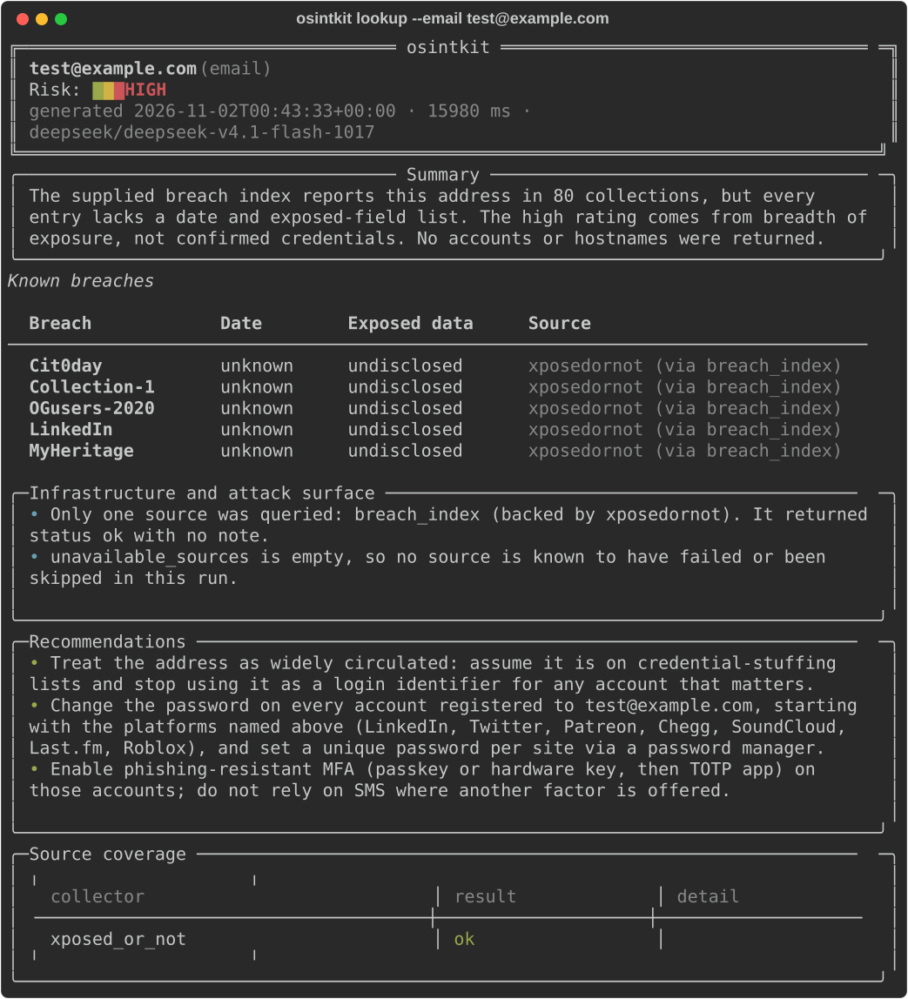

# osintkit

[](https://github.com/sjdsjadjajdjsa/osintkit/actions/workflows/ci.yml)
[](pyproject.toml)
[](LICENSE)
[](https://github.com/astral-sh/ruff)

Public-data OSINT for one email, username, domain, or company: gathered from free sources,
briefed by an LLM acting as a defensive analyst, rendered as a colour-coded report.

`osintkit` uses only public sources: certificate transparency, public DNS, WHOIS, public GitHub
search, free breach indexes, paste archives, and public profile pages. It never logs in on your
behalf and never touches a paid data broker.



A full trimmed report, including breach and account sections, is in
[docs/sample-output.md](docs/sample-output.md).

## Why

Checking what the public record says about you is tedious: a dozen sites, a dozen formats, no
synthesis. `osintkit` runs those checks concurrently, keeps the raw evidence, and turns it into
a briefing with a risk level and concrete hardening advice. Everything is local, every source
is named, and every gap is reported instead of hidden.

Intended for personal privacy checks, authorised pre-engagement recon, and quick due diligence
on a domain or company. Findings are leads to verify, not facts.

## Install

```bash
uv tool install git+https://github.com/sjdsjadjajdjsa/osintkit
# or
pipx install git+https://github.com/sjdsjadjajdjsa/osintkit
```

From a clone, `pip install -e .` also works. Python 3.12+ only.

## Quick start

```bash
export API_KEY=...                 # model key, any OpenAI-compatible endpoint
osintkit doctor --deep             # prove the key and endpoint work
osintkit lookup alice@example.com
```

No key? `osintkit lookup example.com --raw` still collects everything; `--dry-run` shows the
exact synthesis prompt.

Any OpenAI-compatible endpoint works. `--provider venice|openrouter|openai` picks a preset, and
a recognisable key prefix picks one for you; `--base-url` and `--model` always win.

Optional keys: `HIBP_API_KEY` turns on Have I Been Pwned, `GITHUB_TOKEN` lifts GitHub from 60 to
5000 requests/hour. Everything else needs no credentials.

## Commands

| Command | Purpose |
| --- | --- |
| `lookup` | One target, one report (`--email`, `--username`, `--domain`, `--company`) |
| `batch` | A CSV of targets, run concurrently, reported in order |
| `diff` | What changed between two archived runs |
| `history` | Past runs, replayable by id |
| `doctor` | Key, endpoint, and directory checks (`--deep` verifies auth) |
| `collectors` | Every collector and what it touches |
| `cache` / `prune` | Inspect, clear, or age out local state |
| `schema` | The JSON contract the model must satisfy |

Output: default colour report, `--json`, `--markdown` (they combine), `--raw` for collected
data, `--dry-run` for the prompt. Exit codes: `0` ok, `1` synthesis or partial failure, `2` bad
input.

## How it works

```
target -> type detection -> collectors (parallel, cached, retried)
                                 |
                                 v
                     merge + risk signals (deterministic)
                                 |
                                 v
           LLM briefing -> pydantic validation -> one repair retry
                                 |
                                 v
              colour report . JSON . Markdown . archive
```

Collectors degrade to a logged gap, never a dead run; a report is produced even when sources or
the model fail.

- **Merged breaches.** Three indexes listing one incident collapse into one row with every
  source and the earliest date.
- **Risk floor.** Breach count and credential types set a floor the model may exceed but never
  undercut.
- **Cached everything.** 24h default, shorter for volatile sources; repeat prompts cost nothing.
- **Validated output.** Strict JSON schema, one repair round-trip, then a clean failure.

## Collectors

Two dozen sources across four target types, all free and login-free: HIBP (key), XposedOrNot,
LeakCheck, Gravatar, crt.sh (subdomains, certificates, organisation search), public DNS
(A/AAAA/MX/TXT/NS/CNAME plus SPF, DMARC, DKIM, wildcard), passive subdomains, WHOIS, TCP
connect probes, GitHub (profile, commits, user search, org repos), psbdmp with a Gist fallback,
grep.app, Hacker News, Stack Exchange, and username presence. The full table is in
[docs/REFERENCE.md](docs/REFERENCE.md#collectors) or via `osintkit collectors`.

## Safety and legality

- Public data only. No logins, no scraping behind auth, no paid brokers.
- Targets are typed and normalised before any request.
- Requests retry on `429`/`5xx` with backoff and honour GitHub quota headers.
- Results are evidence, not ground truth; the report says which sources were unavailable.
- Cache, logs, and reports stay under `~/.osintkit` (override with `OSINTKIT_HOME`). Retention
  is 30 days by default.

## Limitations

WHOIS is often redacted. GitHub search is shallow. Free breach indexes lag. Port probing only
sees what your network can reach. Model summaries can overstate weak signals. Read the coverage
panel: an empty section may mean "nothing found" or "source skipped".

## Development

```bash
git clone https://github.com/sjdsjadjajdjsa/osintkit
cd osintkit
uv sync --extra dev
pytest
uvx ruff check src tests
```

Tests never touch the network: HTTP is mocked with `respx`, DNS and WHOIS are monkeypatched, and
a recorded model reply covers the full-stack path. CI runs on 3.12 and 3.13. See
[CONTRIBUTING.md](CONTRIBUTING.md) for the collector contract and
[docs/architecture.md](docs/architecture.md) for the module map.

## Licence

MIT. Security reports: [SECURITY.md](SECURITY.md).

`osintkit` is independent tooling. It is not affiliated with any source it queries.
